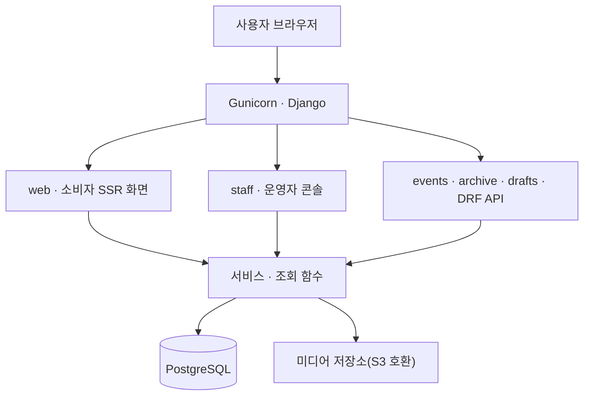

# 시스템 구성과 데이터 설계 개요

README에서 분리한 상세 설명이다. 요청이 어디를 거쳐 처리되는지, 앱별
책임과 의존 방향, 저장 데이터의 생명주기와 DB 제약, 동시·비동기 처리
방식을 다룬다. 작성 기준은 2026-10-28 `main`(`b175ce69`)이다. 숫자는 단위와
출처를 함께 적었다.

## 1. 요청 흐름

사용자 기능은 Django 서버 하나가 처리한다. 화면은 서버 렌더링(SSR), JSON API는
Django REST Framework로 제공하며, 화면과 API가 모두 서버 내부의 서비스·조회
함수를 직접 부른다. SSR 화면이 서버 자신의 HTTP API를 다시 호출하는 흐름은
없다.

대표 유스케이스인 방문 기록 사진 업로드(`POST /api/visit-records/<record_id>/photos/`)의
순서는 다음과 같다. 상세는 `docs/BE/visit-photo-idempotency.md`.

1. 브라우저가 파일 선택 시점에 발급한 멱등 키 `client_token`을 실어 호출한다.
2. DRF 뷰가 세션 인증, 소유자, 요청 제한(30회/분)을 확인한다.
3. `archive/services.py`의 `create_visit_record_photo()`가 트랜잭션을 열고 부모
   방문 기록 행을 `select_for_update`로 잠근다.
4. 같은 `(visit_record, client_token)` 행이 있으면 새로 만들지 않고 돌려준다.
5. 새 요청이면 5장 상한을 확인한 뒤 저장한다. 락 밖에서 난 `IntegrityError`는
   2차 방어로 같은 토큰의 행을 재조회해 돌려준다.

공식 행사 공급에는 세 갈래가 있다.

| 경로 | 처리 흐름 |
|---|---|
| 등록된 수집처 | 활성 `DraftSource`(RSS·Sitemap·HTML) → URL 수집·검증 → 규칙 기반 필드 추출 → 검수 대기 초안 |
| 새 수집처 탐색 | 운영자 탐색 요청 → 로컬 러너가 작업을 임대 → 에이전트가 후보 제출 → 서버 검증 → 수집처 등록·초안 생성 |
| 공개 | 검수 대기 초안 → 운영자 검수·승인(반려 뒤 재오픈 가능) → 공개 이벤트 |

수집처의 기술 검증과 행사 내용의 공개 승인은 서로 다른 단계다. 수집처가
검증을 통과해도 행사 초안은 관리자 승인 전까지 공개되지 않는다.
[수집·탐색 설계](draft-source-agent-discovery.md), [검수 생명주기](draft-review-lifecycle.md)

## 2. 앱별 책임과 의존 방향

기능별 앱을 둔 Django 모놀리스다. Django 앱 7개에 설정 패키지 `config`와
서버 밖에서 도는 `local_runner` 패키지가 더해진다.

| 앱·모듈 | 담당 책임 |
|---|---|
| `accounts` | 인증, 계정 변경, 탈퇴 생명주기(10일 유예) |
| `events` | 공개 행사 데이터와 공개 상태, 행사 조회 API, 행사 텍스트 번역 큐·검증(러너 전용 API, LLM 호출 없음) |
| `drafts` | 초안, 수집처, 검수 흐름, 탐색 작업·후보 검증, LLM 추출 파이프라인 |
| `archive` | 찜, 방문 상태·기록, 개인 항목, 컬렉션, 활동 이력 |
| `staff` | 운영자 콘솔(대시보드, 검수 큐, 이벤트·수집처·계정 운영, 감사 로그) |
| `web` | 소비자 SSR 화면, 사이트맵, 개인 항목의 공식 제보 조정 |
| `core` | 오류 응답·IP 판별·페이지네이션·분석 이벤트 등 공유 처리, LLM 어댑터, 헬스 체크, 카테고리 어휘, 오류 묶음, 보존 정리, UI 번역 지원 |
| `config` | 설정, 루트 URL, 애플리케이션 진입점 |
| `local_runner` | 개인 Mac에서 수집처 탐색 작업을 임대·실행하고 후보를 제출, 행사 텍스트를 번역해 제출 |

앱 내부의 계층 책임:

| 위치 | 처리할 일 |
|---|---|
| View·Serializer | 요청 형식, 인증·권한, 입력과 응답 변환 |
| Service | 업무 규칙, 상태 변경, 트랜잭션 범위 |
| Query·QuerySet | 조회 조건, 필터링, 조회 최적화 |
| Model·DB 제약 | 데이터 관계와 저장 시 지켜야 할 조건 |

**의존 방향.** `core`는 도메인 앱을 임포트하지 않고, `web`은 어떤 앱도
임포트하지 않는 잎(leaf)이다. 도메인 앱 사이에는 `events·drafts ↛ archive`,
`archive ↛ drafts`, `events ↛ drafts`, 도메인 3앱 `↛ staff` 방향 금지가 있다.
여러 앱을 조합하는 화면 때문에 기능 앱끼리 서로 의존하던 문제를 `web` 분리로
풀었고, 그 결과 `core` 팬아웃 21→0, 앱 간 순환 임포트 3쌍→0이 됐다
(`[실측 2026-08-02]`, `docs/BE/web-views-package.md`). 경계는 문서가 아니라
`tests/core/test_architecture_boundaries.py`가 AST 스캔으로 지킨다. 무엇을
잡고 못 잡는지는 `docs/BE/contract-guards.md`에 있다.

`web`에 템플릿 렌더링만 있는 것은 아니다. 개인 항목을 공식 제보로 잇는
`web/promotion.py`처럼 `archive`와 `drafts`의 서비스를 한 트랜잭션에서 조정하는
코드가 여기에 있다. `archive`와 `drafts`는 서로를 임포트할 수 없으므로 두
도메인을 연결할 수 있는 유일한 자리가 이 계층이다.

## 3. 데이터 설계

핵심은 공개 행사, 검수 후보, 개인 기록의 생명주기를 분리하는 것이다.

| 모델 | 저장하는 정보 | 주요 관계·조건 |
|---|---|---|
| `Event` | 행사명, 일정, 장소, 공식 URL, 공개 상태, 다국어 번역(`text_translations`) | 공식 URL 유일성 |
| `EventDraft` | 수집 원문, 추출 후보값, 검수 상태, 출처 구분 | 출처 URL 유일성, 승인·반려·재오픈 이력 |
| `DraftSource` | RSS·Sitemap·HTML 수집처 | URL 유일성, 활성 여부, 최근 수집 상태 |
| `PersonalEntry` | 개인이 등록한 비공식 장소·메모 | 소유자에게만 비공개, 제보 시 초안으로 승격 |
| `EventInterest` | 찜 | 사용자와 대상 조합의 중복 방지 |
| `UserEventStatus` | 예정·방문·놓침 상태 | 사용자별 대상 상태 관리 |
| `VisitRecord` | 방문일과 짧은 후기 | 공식 행사 또는 개인 항목에 연결 |
| `VisitRecordPhoto` | 방문 사진 | 방문 기록에 종속, 기록당 멱등 키 유일 |
| `CollectionItem` | 굿즈와 보유·구함·교환 가능 수량 | 행사·방문 기록 연결은 선택 |
| `ActivityLogEntry` | 사용자 활동 이력 | 달력용 기록, 원본 삭제 후에도 이력 유지 |
| `SourceDiscoveryRun`·`SourceCandidate` | 탐색 작업과 제출 후보 | 작업 상태, 임대 토큰·만료·횟수, 후보별 검증 결과 |
| `StaffActionLog` | 운영자 조작 이력 | 행위자·대상·IP·UA, 실패한 조작은 남기지 않음 |

세 가지 설계 선택:

1. **공식 행사와 개인 항목 중 정확히 하나를 참조한다.** 찜·방문 상태·방문
   기록은 `event`와 `personal_entry`를 동시에 가지거나 둘 다 비울 수 없다.
   `eventinterest_exactly_one_subject` 같은 `CheckConstraint`로 강제하고 조건부
   `UniqueConstraint`로 사용자별 중복을 막는다.
2. **보유·구함·교환 의사를 하나의 상태값으로 합치지 않는다.** 보유는
   `quantity > 0`, 구함은 `is_wanted`, 교환 의사는 `tradeable_quantity > 0`으로
   따로 표현하고, `0 ≤ tradeable_quantity ≤ quantity`를
   `collectionitem_tradeable_lte_quantity` 제약으로 DB까지 내린다.
3. **행사나 방문 기록을 삭제해도 컬렉션은 남긴다.** `CollectionItem`의
   행사·방문 기록 FK는 `SET_NULL`이다.

다른 테이블의 소유자나 연결 관계까지 비교해야 해서 `CheckConstraint`로 내릴 수
없는 규칙은 서비스 계층이 검증하고 그 사유를 모델 주석에 남긴다. `models.py`의
`CheckConstraint`·`UniqueConstraint`·`Index` 선언은 22건이며 그중 19건이
`archive`에 있다 `[실측 rg 2026-10-28]`.

## 4. 정합성·동시 요청 처리

| 문제 | 적용한 처리 | 필요한 이유 |
|---|---|---|
| 응답 유실 후 사진 재전송 | `client_token`과 `(visit_record, client_token)` 유일 제약 | 같은 요청이 사진을 중복 생성하지 않게 함 |
| 사진이 4장일 때 동시 업로드 | 부모 방문 기록에 `select_for_update` | 두 요청이 모두 4장을 보고 저장하는 경합 방지 |
| 5번째 사진 업로드 재시도 | 멱등 조회를 상한 검사보다 먼저 실행 | 이미 성공한 요청을 상한 초과로 거부하지 않음 |
| 방문 완료 시 상태 행 동시 생성 | 자기 소유 `UserEventStatus` 행 잠금, 중복 시 1회 재조회, 뷰는 409 | 상위 자원(Event·User) 잠금은 도메인 경계를 넘고 차단 범위가 넓어 기각 |
| 컬렉션 동시 수정 | 잠금 후 최신 값을 읽고 입력과 병합·검증 | 오래된 값으로 부분 수정의 유효성을 판단하지 않음 |
| 방문 완료와 기록 생성 | 같은 트랜잭션에서 처리 | 상태만 바뀌거나 기록만 생성되는 부분 성공 방지 |
| 활동 이력·감사 로그 생성 | 업무 데이터와 같은 트랜잭션에서 저장 | 실제 작업과 이력의 불일치 방지 |
| 초안 일괄 승인·반려 | 항목별 트랜잭션·행 잠금, 응답에 성공·실패 목록 분리 | 한 항목의 실패가 나머지를 롤백하지 않게 함 |

서비스 검증과 DB 제약은 역할이 다르다. 서비스는 설명 가능한 오류와 업무 흐름
제어를 맡고, DB는 제약으로 표현 가능한 잘못된 저장을 최종 차단한다. 도메인
예외(예: `PhotoLimitExceededError`)는 서비스가 던지고 뷰가 HTTP 상태 코드로
매핑한다. `with transaction.atomic(`은 마이그레이션·테스트를 제외하고 65곳,
`select_for_update(`는 13개 파일에서 쓴다 `[실측 rg 2026-10-28]`.
2026-09-14 DB 락·트랜잭션 검수(트랙 32)에서 결함 7건(세이브포인트 누락, 삭제
뷰 잠금 순서, PATCH 원자성 등)을 찾아 고쳤다(`docs/backlog.md` "현재 상태").

[방문 완료 동시성 계약](visit-completion-concurrency.md), [사진 업로드 멱등성](visit-photo-idempotency.md)

## 5. 비동기·외부 호출 처리

| 처리 | 현재 방식 |
|---|---|
| 일반 사용자 요청 | Gunicorn 웹 워커에서 처리 |
| 운영자의 "지금 수집" | 서버에서 `discover_drafts`를 동기 실행, 캐시 뮤텍스로 중복 실행 차단 |
| 새 수집처 에이전트 탐색 | DB에 작업 저장 → 로컬 러너가 폴링·임대 후 실행 |
| 정기 수집·러너 자동 시작 | 미구현 |
| 서버의 LLM 행사 필드 추출 | 구현되어 있지만 기능 플래그 OFF(`DRAFT_LLM_EXTRACTION_ENABLED = False`) |
| 행사 텍스트 번역 | 로컬 러너가 큐 조회 → 번역 → 제출, 서버는 규칙 검증·저장만. 원문 해시 불일치는 409 |

로컬 러너에는 별도 스레드의 heartbeat(신선도 기준 120초), 임대 토큰과 만료,
재임대 상한 2회(`MAX_LEASES`), 통신 오류 백오프가 있다 `[코드 drafts/discovery_runs.py]`.
서버는 후보의 네트워크 검증을 트랜잭션 밖에서 수행하고, 저장 직전에 행을
다시 잠가 임대 유효성을 재검사한다. Celery·Redis 브로커 대신 DB 작업 상태와
로컬 러너를 쓰는 구성이며, 기본 수집과 후보 검증 일부는 웹 요청 시간을 쓴다.
gunicorn 워커 타임아웃은 아직 명시하지 않았다(`docs/backlog.md` G2).

LLM 추출 파이프라인은 구현이 끝났지만 비용 정책으로 동결돼 있고 휴리스틱
추출이 기본 경로다. anthropic SDK를 얇은 어댑터(`core/llm/`)로 감싸 tool 강제
호출로 구조화 출력만 받고, `stop_reason == "max_tokens"`인 응답은 겉보기에
유효해도 거부하며, 추출값이 원문에 실제로 존재하는지 부분 문자열 대조로
재검증(grounding)하고, 필드별 신뢰도의 최솟값이 0.6 미만이면 상위 모델로 1회
재시도한다 `[코드 drafts/llm_extraction.py, core/llm/client.py, config/settings.py]`.
승인된 초안을 골든셋 삼아 필드별 정확도를 재는 `eval_extraction` 관리 명령이
있다.

[러너 설계와 구현 범위](draft-source-agent-discovery.md), [SSRF 방어](draft-fetching-ssrf.md)
